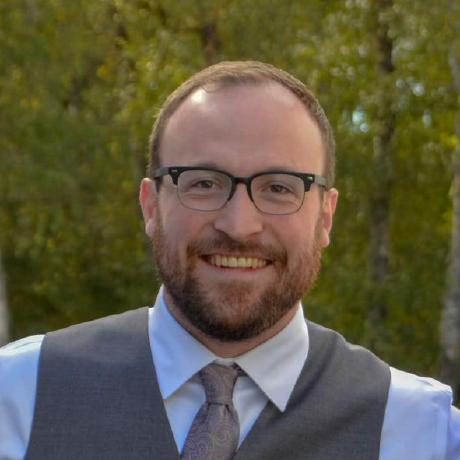

---
# the default layout is 'page'
icon: fas fa-info-circle
order: 1
---

{: .left width="200"}

Taylor Firman is a data scientist from Seattle, WA with a passion for science, sports, and generally mathematical things. He received a B.S. in Physics and Mathematics from the University of Puget Sound and a PhD in Molecular and Cellular Biophysics from the University of Denver with a dissertation entitled "Learning from Disorder and Noise in Physical Biology".

His research centered around the role of noise and disorder in the realm of biology, using a combination of simulated and experimental data to demonstrate the occasional benefit of stochasticity. He currently works as a Research Informatics Lead at Fred Hutchinson Cancer Center, developing bioinformatic pipelines for genomic analysis and consulting with research teams on effective computing strategies.

As a Seattleite (and married to a former Philadelphian), Taylor may pay particular attention to the Seattle Mariners and Philadelphia 76ers in any sports-related analysis, but he will do his best to remain impartial and give due diligence to all sports franchises involved.
